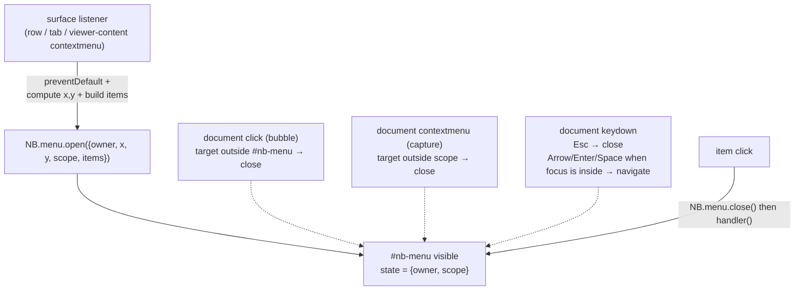

# Context menus — shared-menu blueprint

Three independent right-click menus exist today: the sidebar's
(`sidebar.js`, serving tree rows, bookmark rows, and the tree root), the
tab bar's (`tabs.js`), and hybrid mode's formatting menu (`hybrid.js`,
the only one with separators, submenus, keyboard hints, and keyboard
navigation). All three render into a `<div class="context-menu">` styled
by one shared CSS block, and all three hand-roll the same plumbing:
build items, position at the pointer, close on outside click. The
plumbing has already drifted — three different `addMenuItem` signatures,
three different "what counts as outside" scopes, five copies of the
positioning math with two different magic numbers.

New module: `static/js/menu.js` (`NB.menu`). One singleton menu element,
data-driven item descriptors, one document-level close dispatcher.
Surfaces keep what is genuinely theirs — *when* the menu opens, *what*
the items are, and the element that counts as "inside" — and stop
re-implementing *how* a menu works.

Sibling docs: [frontend.md](frontend.md) for the module inventory and
load order, [hybrid-editing.md](hybrid-editing.md) for the hybrid mode
this menu lives in, [table-select.md](table-select.md) for the style of
this document. Load-order and PRECACHE facts cited below were verified
against `templates/index.html:1099-1132`, `static/sw.js:38-67`, and
`tests/dom/test_dom.js:1560-1601`.

---

## 1. Current-state assessment

### 1.1 Three implementations of one widget

| Concern | sidebar.js | tabs.js | hybrid.js |
| --- | --- | --- | --- |
| Host `<div>` | `#context-menu` (lookup `sidebar.js:10`) | `#tab-context-menu` (`tabs.js:25`) | `#hybrid-context-menu` (`hybrid.js:45`) |
| Open entry | `openMenu` :601, `openBookmarkMenu` :447, `openRootMenu` :664 | `openMenu` :752 | `openMenu` :5695 → `buildMenu` :5540 |
| Item builder | `addMenuItem(label, handler, danger)` :637 | `addMenuItem(label, handler, opts)` :778 | `addMenuItem(label, handler, danger, opts)` :4570 |
| Separators | raw `menuEl.appendChild(document.createElement("hr"))` (×4 in :609-627) | raw `<hr>` :768 | `addMenuSep` :4588 |
| Submenus | — | — | `addSubmenu` :4596, `addSubItem` :4620 (kbd hints) |
| Positioning | inline ×3 (:468-471, :631-634, :674-677) | `positionMenu` :788 | inline :5718-5721 |
| Close | `hideMenu` :645 | `hideMenu` :795 | `hideMenu` :4638 (also clears `.submenu.open`) |
| Close-on-click listener | any click :649 | any click :796 | click outside menu :5747-5749 |
| Close-on-right-click listener | outside `#sidebar` :650-658 | outside `#tab-bar` :797-800 | outside `#viewer-content`, **capture** :5780-5782 |
| Esc | — | — | :5750-5752 |
| Keyboard nav | — | — | Arrow/Enter/Space :5757-5777; Shift+F10 anchor :5704-5717; focus first item :5726-5727 |
| Disabled items | — | `{disabled}` :783 (`btn.disabled` only) | `{disabled, title}` :4574-4583 (also `aria-disabled`) |
| "What was open for" state | `menuCtx` :25 | `menuPath` :750 | — |

### 1.2 Signature drift is real, not hypothetical

The three `addMenuItem` variants cannot be swapped: sidebar takes a bare
`danger` boolean (:637), tabs takes an options object with
`{danger, disabled}` (:778), hybrid takes both a positional `danger`
*and* an options object `{disabled, title}` (:4570). A fourth right-click
menu would have to pick a style and copy a fourth plumbing set. Only
hybrid can express separators, submenus, disabled-with-reason, and
keyboard hints — those features are trapped inside the largest module.

### 1.3 Positioning copy-pasted five times with drifting constants

The clamp `x = Math.min(e.clientX, window.innerWidth − W)` appears five
times: `sidebar.js:468`, `:631`, `:674` with **W = 190**, and
`tabs.js:789`, `hybrid.js:5718` with **W = 200**. W is a *guess at the
menu's width*, not a measurement — a menu wider than the guess (long
labels, kbd hints) overflows the viewport's right edge. The y-clamp
(`window.innerHeight − menuEl.offsetHeight − 10`) is correct because it
measures, and it too is copied five times.

### 1.4 Three close scopes, eight document listeners

Each module carries its own global listeners to close *its* menu:
sidebar 2 (:649, :650), tabs 2 (:796, :797), hybrid 4 (:5747, :5750,
:5757, :5780) — eight in total, all firing on every click in the app.
Cross-menu closing works only because every module re-implements the
outside-right-click rule with its own scope: right-clicking the sidebar
while the hybrid menu is open closes the hybrid menu (:5780-5782), and
vice versa (:650-658). Remove any one listener and a menu lingers.

The scopes are also an ordering hazard. The tree-row handler
(`sidebar.js:95-97`, :137-139) opens a menu during bubbling; the
document-level `contextmenu` handler then fires with the same target.
It must recognize the target as *inside the sidebar* and not close the
menu the row handler just opened. This exact bug shipped once — the
regression guard at `tests/dom/test_dom.js:13217-13223` asserts the
bookmark menu is **visible** (not merely present) after a row
right-click, with a comment describing the history.

### 1.5 Dead state

`menuCtx` (`sidebar.js:25`, written :448, :602, :665, cleared :647) and
`menuPath` (`tabs.js:750`, written :753, cleared :795) are **never
read**. The handlers already capture their target in closures. This is
state that suggests a "menu knows what it was opened for" contract that
does not exist — and that a future maintainer might start relying on
without anyone keeping it correct.

### 1.6 Risk summary

| Risk | Bug class it enables |
| --- | --- |
| Five copies of positioning math | right-edge overflow on wide menus (already latent via W-guesses) |
| Three `addMenuItem` dialects | every new menu copies a fourth dialect; features stay siloed |
| Eight global close listeners, three scopes | menus lingering open; re-introducing the :13217 ordering bug |
| Dead `menuCtx`/`menuPath` | future code reading stale state that nothing maintains |
| Hybrid-only a11y (Esc, nav, `aria-disabled`) | the other menus are permanently keyboard-inaccessible without re-copying |

---

## 2. Proposed abstraction — `NB.menu`

### 2.1 Decisions

- **One module, one element.** `static/js/menu.js` (IIFE, `NB.menu`)
  creates a single host `<div id="nb-menu" class="context-menu" hidden>`
  appended to `document.body` at load. The three per-surface divs in
  `templates/index.html:344-350` are deleted. One element makes "two
  menus open at once" *structurally impossible* instead of merely
  forbidden, and deletes an axis of state ("which host is open").
- **The class `.context-menu` is the compatibility contract.** All
  existing CSS (`style.css:2552-2614`) and
  `mermaid-designer.js:477`'s `closest(".context-menu, …")` keep working
  unchanged. The element is **hidden, never removed** — the designer's
  invoker check relies on the clicked menu button staying connected to
  a `.context-menu` ancestor (see §4.4).
- **Surfaces decide *when* and *what*; the module decides *how*.**
  Triggers (`contextmenu` listeners on rows/tabs/viewer-content),
  `preventDefault` policy, item lists, and the close scope stay at the
  surfaces. Building, positioning, closing, keyboard handling, and the
  outside-close dispatcher move into the module.
- **Data-driven items.** Surfaces pass a plain array of descriptors;
  the module renders DOM. This kills the three imperative builder
  dialects and makes item lists testable as data.

### 2.2 Public API

```js
NB.menu.open({
  owner: "sidebar",          // required string — who opened it (see close())
  x: e.clientX, y: e.clientY, // required anchor point; the module clamps
  scope: sidebarEl,          // required element — "inside" for close-on-right-click
  items: [ /* descriptors, below */ ],
  focusFirst: true,          // optional (hybrid only today): focus first enabled
                              // item so arrows/Enter work without a pointer
});

NB.menu.close();      // close whatever is open (idempotent)
NB.menu.close("hybrid"); // close only if the open menu's owner === "hybrid"
```

Two functions; nothing else. `isOpen` and an `.el` accessor are not
needed — tests select `#nb-menu` and read `.hidden`, exactly as they do
today.

**Item descriptor schema** (one schema, recursive for submenus):

```js
{ label: "Delete",            // string, required (except separators)
  handler: fn,                // runs AFTER the menu closes (order preserved)
  danger: true,               // red text (.danger, style.css:2575)
  disabled: true,             // btn.disabled + aria-disabled + title, no click listener
  title: "No visual editor…", // tooltip / disabled reason
  kbd: "Alt+Up",              // right-aligned <kbd class="context-menu-kbd"> hint
  submenu: [ …descriptors ] } // one flyout level; items recurse
{ separator: true }
```

- `icon` is **not** in the schema: no current menu uses icons. Add the
  key when one does; unknown keys are ignored, so the schema extends
  without a migration.
- **Validation at `open()`**: every item must be a separator, a submenu
  parent, disabled, or carry a function `handler` — otherwise
  `open()` throws a `TypeError`. Item lists are static literals per
  surface, so a typo (`hanlder`) fails at the first right-click in dev
  instead of rendering a silently dead button.
- `disabled` renders exactly as hybrid does today (`hybrid.js:4574-4583`):
  `btn.disabled = true`, `aria-disabled="true"`, `title` carried, and
  **no click listener attached**. The designer test at
  `tests/dom/test_dom.js:22148-22155` asserts all three attributes —
  this contract is load-bearing.

### 2.3 Rendering rules (DOM contract preserved)

The module produces byte-identical DOM to today's menus so the CSS block
(`style.css:2552-2614`) and the flyout rules (`:2587-2614`, which key off
`.submenu > .context-menu` and `left: 100%`) need no changes:

- plain item → `<button>label</button>`; click = `NB.menu.close(); handler()`
  (close-then-run, as in all three modules today — `sidebar.js:641`,
  `tabs.js:784`, `hybrid.js:4582`).
- separator → `<hr>`.
- submenu → `<button class="submenu">label<div class="context-menu">…</div></button>`;
  click on the parent `stopPropagation`s, closes sibling `.submenu.open`,
  and toggles `.open` (ported from `hybrid.js:4606-4613`); hover is pure
  CSS. Flyout items recurse; separators inside flyouts work (hybrid's
  List flyout has one, `hybrid.js:5580`).
- `kbd` → `<kbd class="context-menu-kbd">` appended inside the button —
  styled by `style.css:1166-1167`, available at top level and in
  submenus alike (the rule is class-based).
- `role="menu"` is set on the host at every open (today only hybrid
  does, `hybrid.js:5725`). Aria-only; invisible to behavior; sidebar and
  tabs gain it for free.

### 2.4 Positioning, centralized

One named constant, measured widths:

```js
const VIEWPORT_EDGE = 10;
x = Math.min(anchorX, window.innerWidth - el.offsetWidth - VIEWPORT_EDGE);
y = Math.min(anchorY, window.innerHeight - el.offsetHeight - VIEWPORT_EDGE);
```

Build → unhide → measure → clamp → set `left/top`, the same order all
three modules use today (measure after unhide, e.g. `sidebar.js:630-634`).
The 190/200 width guesses die; `offsetWidth` is measured, so wide menus
no longer overflow the right edge. `VIEWPORT_EDGE = 10` matches today's
y-margin exactly (`:469`, `:632`, `:675`, `:790`, `:5719`); the x edge
gains the same 10 px margin (today a guessed-width menu could touch the
viewport edge). No top/left flipping: menus grow down-right and the
y-clamp handles bottom overflow, as today.

### 2.5 Keyboard handling

- **Esc**: one document `keydown` listener in the module closes any open
  menu (no `preventDefault`, no `stopPropagation` — identical to
  `hybrid.js:5750-5752`, so other Esc consumers are unaffected). Now
  universal, free.
- **Arrow/Enter/Space navigation**: ported from
  `hybrid.js:5757-5777` into the module. Gated on "a menu is open **and**
  focus is inside it", `preventDefault` only inside that guard. Since
  arrows only act once focus is in the menu, this costs sidebar/tabs
  nothing until they opt in.
- **Keyboard invocation (Shift+F10 / Menu key)** stays at the surface.
  Only hybrid has focusable blocks (`mermaid.js:200` sets `tabIndex = 0`
  exactly for this, comment `mermaid.js:197-199`). Hybrid keeps its
  detection — a `contextmenu` event with `clientX/Y === 0` anchored to
  the focused `.mermaid-container`/`.mermaid-error` rect + 8 px
  (`hybrid.js:5704-5717`) — and passes the computed `x`/`y` to
  `NB.menu.open`. The module takes coordinates only; no `anchor`
  element option (one caller, no second use in sight).
- **`focusFirst: true`** (hybrid passes it): focus the first
  non-disabled button (`hybrid.js:5726-5727`). Default false, so
  sidebar/tabs keep their pointer-only behavior. Making it universal is
  a separate decision (§8).

### 2.6 What stays out: the edit-bar dropdowns and table-view popovers

**Out of the abstraction — deliberately.**

- The edit-bar dropdowns (`.eb-menu`, `.eb-table-menu`, `.eb-list-menu`;
  markup `templates/index.html:160-211`, wiring `editbar.js:696-698`,
  close rules `:911-932`) are **left-click** menus on anchored buttons
  inside the bar: persistent DOM authored once in markup, positioned by
  CSS containment (no fixed-position viewport math), items are
  `button[data-act]` handled by one delegated action map
  (`editbar.js:911-920`), and the close scope is each menu's own anchor
  wrapper (`.eb-overflow`, `.eb-list`, …).
- The table-view popovers (`.nb-tv-pop`, `table-view.js:698-790`) are
  anchored absolutely to a header cell inside a positioned overlay and
  contain **live-applied widgets** — radio sort actions that update in
  place and checkbox rows that apply on change without closing
  (`table-view.js:705-725`, `:764-783`).

What these share with context menus is only the "transient popup closes
on outside click" idiom. Their contracts differ in every load-bearing
way: trigger (left vs. right click), lifecycle (persistent vs.
rebuild-per-open), positioning (anchored vs. viewport-fixed), items
(widgets vs. close-on-act commands). Unifying them would need an option
for every difference — a framework inside the module, one implementation
wearing three shapes. If a future dropdown needs *rebuild-per-open
descriptors + fixed positioning + close-on-act*, it should use
`NB.menu`; widget popovers stay custom.

---

## 3. Close / ownership model

### 3.1 One dispatcher, registered once

`menu.js` registers exactly **three** document listeners at load,
permanently; each is a cheap no-op whenever no menu is open (one
`hidden` check). This replaces today's eight:



- **Click (bubble)**: outside the menu element → close. Clicks *inside*
  the menu never close via the dispatcher — items close themselves,
  submenu toggles `stopPropagation`. Accepted micro-delta: today
  sidebar/tabs close on a click anywhere *including* menu padding
  (`sidebar.js:649`, `tabs.js:796`); after, a padding click leaves the
  menu open (hybrid's rule, `hybrid.js:5747-5749`, becomes the single
  rule).
- **Contextmenu (capture)**: target outside the open menu's `scope` →
  close. Capture phase so the dispatcher runs *before* surface handlers
  and regardless of `stopPropagation` — hybrid already chose capture
  (`hybrid.js:5782`), and capture also makes the §1.4 ordering hazard
  impossible by construction: the dispatcher decides close/no-close
  *first*, then the surface's row handler calls `open()`, which replaces
  content. A right-click inside the scope never closes — the row's own
  handler is about to open a menu for the new target anyway. A
  right-click **on the open menu itself** is outside every scope (menus
  live at body level), so it closes — same as today for all three.
- **Keydown**: Esc closes (§2.5).

### 3.2 Single-open policy

Structural: one host element, `open()` clears and rebuilds it, so at
most one menu exists. No cross-menu close logic anywhere — opening
surface B's menu while surface A's is showing is just an `open()` that
happens to reuse the element. The per-surface "close everyone else's
menu" listeners are deleted, not ported.

### 3.3 Ownership

`open()` records `{owner, scope}`; `close(owner)` closes only on a
match. The one real caller is hybrid's teardown — `exit()` currently
calls `hideMenu()` at `hybrid.js:4330` — which becomes
`NB.menu.close("hybrid")`: leaving hybrid mode retires its menu without
assuming nothing else could be open (they can't, but the call states
intent and stays correct through the per-surface migration steps).

No `NB.evt` events, no `onClose` callback, no `isOpen()`: no consumer
exists. Add them when one does.

---

## 4. Integration

### 4.1 `sidebar.js` — three open paths, flat items

The row/root/bookmark listeners stay: `:95-97` (dirs), `:137-139`
(files), `:243-246` (bookmarks), `:679-683` (tree root) — all keep their
`preventDefault`. Each open function becomes *build a descriptor array,
then one call*:

- `openMenu` (`:601-635`) → items: `Open` (files), `New file
  here…/beside…`, `New folder here…`, sep, `Export…` (files),
  `Rename / Move…`, `Copy…`, bookmark toggle with state-dependent label
  (`:618-622`), optional sep + `Collapse all folders` when
  `treeHasDir(treeCache)`, sep, `Delete` (`danger`).
- `openBookmarkMenu` (`:447-472`) and `openRootMenu` (`:664-678`) →
  same shape.
- All three call `NB.menu.open({ owner: "sidebar", x: e.clientX,
  y: e.clientY, scope: sidebarEl, items })`. Hoist `sidebarEl` to a
  module const (`document.getElementById("sidebar")`) — today it is
  re-derived per event at `:657`.
- Delete: `addMenuItem` (`:637`), `hideMenu` (`:645`), the two document
  listeners (`:649-658`), the inline positioning (`:468`, `:631`,
  `:674`), and the dead `menuCtx` (`:25`).

### 4.2 `tabs.js` — flat items with disabled states

- `openMenu` (`:752-776`) → items: `Pin`/`Unpin`, `Show in file
  sidebar`, `Export…`, sep, `Close` (`danger`), `Close others`
  (`disabled: !others.length`), `Close to the right`, `Close to the
  left` — then `NB.menu.open({ owner: "tabs", scope: barEl, … })`.
- Delete: `addMenuItem` (`:778`), `positionMenu` (`:788`), `hideMenu`
  (`:795`), the document listeners (`:796-800`), dead `menuPath`
  (`:750`). The tab-row listener (`tabs.js:387`) keeps its
  `preventDefault`.

### 4.3 `hybrid.js` — submenus, focus, keyboard anchor

- `buildMenu` (`:5540-5672`) becomes `buildItems(e)` returning the
  descriptor array, preserving every conditional: the `Table` submenu
  only when the click is inside a table (`:5587-5590`); `Design
  diagram…` disabled with `title` for render-only types (`:5610-5614`)
  vs. enabled (`:5616`); `Edit <plugin> source` vs. `Edit code block`
  (`:5619-5623`); List-flyout `Move item up/down` with `kbd: "Alt+Up" /
  "Alt+Down"` only when the caret is in a list (`:5578-5583`).
- `openMenu` (`:5695-5728`) keeps the hybrid-specific gates and becomes:
  guard on `active`; `e.preventDefault()` (`:5697`); capture
  `savedRange` (`:5701`, restored by paste, `:3878-3880` — stays in
  hybrid); resolve the anchor — pointer coords, or the focused block's
  rect + 8 px when `clientX/Y` are 0 (`:5704-5717`); then
  `NB.menu.open({ owner: "hybrid", x: anchorX, y: anchorY, scope:
  viewerContentEl, items: buildItems(e), focusFirst: true })`.
- The `viewerContentEl` `contextmenu` listener (`:5733-5739`) keeps the
  native-menu escape hatch: `if (active && isPlainTextTarget(e)) {
  NB.menu.close(); return; }` (no `preventDefault`, so spellcheck
  suggestions show). `isPlainTextTarget` and
  `NATIVE_MENU_BLOCKED_SELECTOR` (`:155-158`) stay in hybrid — they are
  editing-policy, not menu mechanics.
- `exit()` (`:4330`) → `NB.menu.close("hybrid")`.
- Delete: `addMenuItem`/`addMenuSep`/`addSubmenu`/`addSubItem`
  (`:4570-4636`), `hideMenu` (`:4638`), the four document listeners
  (`:5747-5782`), the `menuEl` lookup (`:45`).

### 4.4 Shared files

- `templates/index.html`: add `<script src="/static/js/menu.js" defer></script>`
  **after `blocks.js`** (`index.html:1105`, before `mermaid.js` at
  `:1106`). The earliest consumer in load order is `hybrid.js` at
  `:1113`; `sidebar.js` (`:1120`) and `tabs.js` (`:1123`) load later.
  Grouping it with `blocks.js` keeps the "shared infra first" pattern.
  Delete the three menu divs (`:343-350`).
- `static/sw.js`: add `"/static/js/menu.js"` to `PRECACHE` after
  `blocks.js` (`sw.js:40`) — an app module missing from the precache
  breaks offline, which is the point of the list.
- `static/js/mermaid-designer.js`: `:477`
  `el.closest(".context-menu, #hybrid-context-menu")` →
  `el.closest(".context-menu")`. The singleton carries the class, so
  the first half already matches; the ID half is dead after migration.
  Same change, behavior identical: the designer's `restoreFocus`
  detects that its invoker was a menu button (the menu hides on item
  click *before* `designMod.open` runs) and falls back to the diagram
  block. The menu element being persistent-and-hidden — never removed —
  is what keeps the invoker `isConnected` and `closest`-matching.

---

## 5. Style unification

**No CSS changes are required.** All per-menu styling is already shared
through the one `.context-menu` block (`style.css:2552-2614`), and every
feature the module renders has class-based rules: hover/danger
(`:2574-2575`), separators (`:2576-2580`), the submenu flyout geometry
(`:2587-2614`, keyed off `.submenu` and a nested `.context-menu`, not
IDs), kbd hints (`:1166-1167`), and disabled items (`:1335-1337`). The
`z-index: 1000` (`:2554`) and the layering comment at `:719` are
unaffected.

The drift that exists is in JS, not CSS, and §2 collapses it:

| Drift | Today | After |
| --- | --- | --- |
| Viewport clamp constant | 190 (sidebar ×3) vs. 200 (tabs, hybrid) | measured `offsetWidth`, one `VIEWPORT_EDGE` |
| Disabled rendering | tabs: `btn.disabled` only (`tabs.js:783`) | `disabled` + `aria-disabled` + `title`, one renderer (hybrid's, `:4574-4583`) |
| `role="menu"` | hybrid only (`:5725`) | every open |

One optional cleanup while touching nothing else: the
`.context-menu-kbd` rules at `style.css:1166-1167` live far from the
menu block; moving them next to `:2552` groups the menu's styles.
Cosmetic; do it or don't.

---

## 6. Test impact

### 6.1 Existing blocks that select menu DOM (all need selector updates)

Every test below selects by the old host IDs; each becomes
`$("nb-menu")` / `#nb-menu`. Verified in `tests/dom/test_dom.js`:

| Block | Lines | What it asserts (must keep passing) |
| --- | --- | --- |
| Harness HTML | :320-322 | the three divs — **delete**; the module creates `#nb-menu` itself |
| Hybrid menu structure | :6425-6530 | top-level groups + nested `.context-menu` flyouts; the flyout queries (`:6472`, `:6490`, `:6502`, `:6522`) match by **class** and keep working unchanged |
| Table submenu guard | :7750-7788 | "Toggle header row" reachable + refuses demotion |
| List submenu reorder | :10925-10956 | Move item down via the List flyout + live announcement |
| Empty-tree root menu | :12124-12139 | root menu on empty-area right-click, New file flow |
| Collapse-all menus | :13005-13049 | root/row menus offer Collapse all folders |
| Bookmark menus | :13172-13280 | Add/Remove bookmark labels; **visibility regression guard :13217-13223** (keep verbatim — it now guards the dispatcher's in-scope rule); Rename/Move re-keying |
| Tab menu | :13709-13843 | Pin/Unpin ordering, Close others/right/left enabled matrix, hides on outside click (:13816-13818) |
| Export entry points | :16629-16678 | tree-row and tab menus open the modal targeting that file |
| Designer matrix | :22099-22157 | item shown for admin, absent for viewer; render-only type `disabled` + `aria-disabled` + `title` (:22148-22155) |

Browser suites: `tests/browser/test_hybrid_browser.js:1798`, `:1814` and
`tests/browser/test_designer_browser.js:142-143` select
`#hybrid-context-menu` (and `:not([hidden])`) — update to `#nb-menu`.

### 6.2 New `== menu module ==` block

Add a unit-style block right after the module loads (next to the other
early blocks, load list at `test_dom.js:1570-1601`), driving `NB.menu`
directly:

- render: item order, `<hr>` for separators, `.danger`, `disabled` +
  `aria-disabled` + `title` + inert on click, `kbd` hint.
- item click closes the menu **then** runs the handler (order assert:
  handler observes `hidden === true`).
- `open()` throws on an item with no `handler`/`submenu`/`disabled`.
- clamp: jsdom has no layout, so stub `innerWidth/innerHeight` and
  `offsetWidth/offsetHeight`, then assert the measured-width formula —
  this is the regression test for the 190/200 magic numbers.
- close paths: outside click; Esc; right-click outside `scope`; **not**
  closed by a right-click inside `scope` (module-level twin of the
  :13217 guard); `close(owner)` leaves other owners alone.
- submenu: `button.submenu > div.context-menu` shape, click toggles
  `.open` and closes siblings, flyout item click closes the whole menu.
- focusFirst: first non-disabled button focused when `true`, untouched
  when absent.

### 6.3 The registry-completeness question

**No renderer-style registry.** `blocks.js` has a registry because each
renderer drags four artifacts that must stay in sync (`index.html`,
`sw.js`, the `ai.js` prompt, `agent.md`) and the completeness test
enforces it. Menu surfaces have no per-surface artifact and no external
documentation — a "surface registry" would be a list with no consumer.
The useful slice of the pattern is two structural checks, in the
completeness style, added to the module block:

- `read("templates/index.html")` contains the `menu.js` script tag
  **before** the `hybrid.js` tag (load order is load-bearing).
- `read("static/sw.js")` PRECACHE includes `menu.js`.

---

## 7. Migration order

Each step lands green; every step is one surface plus its own tests.

1. **Land `menu.js` inert.** Module + singleton host + `index.html`
   script tag + `sw.js` PRECACHE + harness `evalIn` (after `blocks.js`,
   `test_dom.js:1574`) + the new `== menu module ==` block. Nothing
   consumes `NB.menu` yet; the three legacy menus coexist with the
   unused singleton. Suite green.
2. **Migrate `tabs.js`** (smallest: flat items, one open path). Update
   the tab-menu selectors (:13709-13843); delete `#tab-context-menu`
   from `index.html` and the harness. Green.
3. **Migrate `sidebar.js`** (three open paths, flat items). Update
   :12124-12139, :13005-13049, :13172-13280, :16629-16658; delete
   `#context-menu` divs. Green.
4. **Migrate `hybrid.js`** (submenus, `focusFirst`, keyboard anchor,
   `isPlainTextTarget`, `exit` close). Update :6425-6530, :7750-7788,
   :10925-10956, :22099-22157 and both browser suites; delete
   `#hybrid-context-menu` divs; simplify `mermaid-designer.js:477`.
   Green.
5. **Update the docs.** `frontend.md` module inventory gains the
   `menu.js` row and drops "right-click menus" from the sidebar/tabs
   descriptions; this doc becomes the reference.

During steps 2-4 the not-yet-migrated surfaces keep their own
listeners; they operate on different elements than `#nb-menu`, so no
step interferes with its neighbors.

### Non-goals

- No generic popup framework: edit-bar dropdowns and table-view
  popovers stay as-is (§2.6).
- No icons, checked/radio items, or multi-level submenus (CSS supports
  one flyout level; hybrid needs exactly one).
- No focus trap; `focusFirst` stays opt-in (§8).
- No flyout viewport flipping (§8).
- No server, `agent.md`, or config changes — menus are pure UI;
  `agent.md` documents the HTTP API.
- No new consumers forced: `vimnav`, `windows`, `activity` do not open
  menus today and are untouched.

---

## 8. Risks & open questions

1. **jsdom has no layout.** `offsetWidth/offsetHeight` are 0, so clamp
   assertions must stub dimensions; real-browser positioning is covered
   only by the two browser suites. Same situation as today's
   `offsetHeight` y-clamp, so no regression — but the unit test must
   stub, not skip.
2. **Submenu flyouts can overflow the right edge** near the viewport
   border (CSS pins them to `left: 100%`, `style.css:2599-2606`).
   Pre-existing, hybrid-only, unchanged by this design. Fixing it needs
   JS flyout repositioning — defer until someone hits it.
3. **Esc is not consumed.** With a menu open, Esc also reaches other
   Esc handlers, exactly as today (`hybrid.js:5750-5752` has no
   `stopPropagation`). If the menu should claim Esc when open, that is a
   deliberate behavior change to decide separately.
4. **`focusFirst` universality.** Sidebar/tabs keep pointer-only menus
   for now; enabling keyboard-first focus there is one flag each (the
   nav code is already shared and focus-gated). Do it when someone asks
   for keyboard-driven file-tree menus.
5. **Old IDs disappear.** Anything outside the repo selecting
   `#context-menu`/`#tab-context-menu`/`#hybrid-context-menu` breaks.
   Single-user app; the in-repo consumers (mermaid-designer, both test
   suites) are handled in §4.4/§6.1.
6. **`open()` throws on malformed descriptors.** A shipped surface bug
   would break that surface's right-click loudly. Accepted: descriptors
   are static literals, the module block tests validation, and silent
   dead buttons are the alternative this rule exists to kill.
7. **One element, one dispatcher, forever.** The three document
   listeners run on every click/contextmenu/keydown for the life of the
   page, gated by a `hidden` check — strictly cheaper than today's
   eight, and no new listener is added per surface.