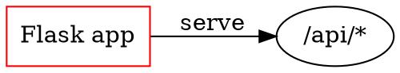
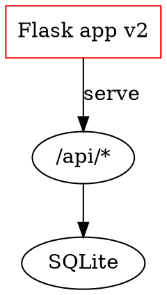

# Graphviz / WaveDrom design windows — architecture

Status: design for implementation. Owner: `architect`. No source was changed.
Date: 2026-10-20.

Inputs (both read in full):

- `docs/product/dot-wavedrom-design-window.md` — normative **behavior**.
- `docs/design/dot-wavedrom-editor.md` + mockup — normative **UI/layout**.
- `docs/architecture/mermaid-designer.md` + `static/js/mermaid-designer.js` —
  the write-back contract this feature mirrors.

Where the two normative docs disagree, **the product doc wins for behavior** and
the design doc wins for presentation. The scope cuts that follow from this are
listed in §2 (D3); they are decisions, not oversights.

Everything below was verified against the real code (`hybrid.js` menu path
6188-6218, `blocks.js` registry, `windows.js`, `sw.js`, the jsdom harness) and
against the real vendored renderers: Viz.js 2.1.2 / Graphviz 2.40.1 WASM was run
in Node, and WaveDrom 3.3.0 was rendered in jsdom, to pin the SVG mapping facts
in §5 and §6.

## 1. Goal

Right-clicking a rendered `dot`/`graphviz` or `wavedrom` block in hybrid mode
offers **Design graph…** (Graphviz) or **Design timing…** (WaveDrom), which
opens a structured editor window with a live
preview. The note is written only on Apply, as a plain Markdown fence, through
the existing hybrid DOM write-back path. No server changes.

```
hybrid.js ──right-click──▶ blocks.js pluginTypes() ──design flag──▶ NB.dotDesign / NB.wavedromDesign
                                                                    │ open(hit)
                                                                    ▼
                                                          designer-shell.js (owns #dw-designer-overlay)
                                                           │ lifecycle: states, Esc/Tab, dirty, apply
                                                           ▼
                                              dot-designer.js        wavedrom-designer.js
                                              model + grammar         model (parsed object)
                                              └── NB.viz.renderSvgElement ── NB.wavedrom.renderSvgElement/parseSource
                                                  (new exports; renderOne refactors onto them)
```

## 2. Key decisions

**D1 — One new sibling overlay, shared by dot and wavedrom; the Mermaid overlay
is untouched.** `#dw-designer-overlay` (class `settings-overlay`, markup a
sibling of `#designer-overlay` before the phone layers in `index.html`).

- `mermaid-designer.js` gates its document-level Esc / Tab / Ctrl+Z handlers and
  its dirty-close state on *its own* overlay's `hidden` flag. Sharing that
  overlay would make those handlers live during a dot/wavedrom session
  (double-handled Esc, two Tab traps, racing dirty confirms). Refactoring
  shipped, tested mermaid code for this is pure risk with no reuse win, because…
- …the two *new* editors share one shell module (`designer-shell.js`) that
  exclusively owns the new overlay. One overlay, one owner, no cross-module
  state. `data-designer-lang="dot|wavedrom"` (design doc §3.1) scopes the CSS.
- `windows.js` keys persisted window geometry by overlay id, and wires every
  `.settings-modal` at boot — the new overlay gets drag/resize/geometry free.
- The three global `modalIsOpen` guards (`shortcuts.js`, `vimnav.js`,
  `table-select.js`) match `.settings-overlay:not([hidden])`; the class is
  inherited, so global note shortcuts are blocked under the window with **zero**
  changes to those files.
- The shell markup is a structural copy of the Mermaid shell with `dw-` ids
  (~90 lines of static HTML). Generating it from a JS template instead would be
  machinery for two call sites; every other modal in the app is static markup.
  The generic `.designer-btn/.designer-field/.designer-state/...` classes are
  top-level in `style.css` and are reused as-is.

**D2 — One shared shell module plus two controllers, created exactly twice.**
`static/js/designer-shell.js` owns everything genuinely identical in the two
windows: overlay open/close, loading/error states, status + alert banner,
footer wiring, Esc/backdrop/Cancel/× with the dirty guard, focus capture/return
and Tab trap, target capture/re-resolve, the fixed Apply order, the
**Edit source instead** fallback. The language modules own everything genuinely
different: the model, the preview, canvas selection, the sidebar/inspector
forms, serialization.

This is the third copy of the apply/capture/resolve lifecycle in the codebase
(`mermaid-designer.js:3403-3717` is the second). Writing it twice more would be
~600 duplicated lines around the riskiest path in the feature. The shell
mirrors the mermaid order **exactly**, so the two remain diffable.
Refactoring `mermaid-designer.js` onto the shell is deliberately **rejected for
this change** — shipped behavior stays untouched; a later mechanical swap is
possible because the orders are identical.

Not built: no controller registry, no event bus. `NB.designerShell` is a
singleton with `open(controller, hit)`; each language module passes a plain
controller object (§3).

**D3 — v1 behavior set = the design doc.** The full Graphviz §6 and WaveDrom
§7 controls are implemented: shape/style/line/arrow, optional auto IDs, the
wave character track/glyph palette/slice ruler, `config.hscale`, signal
reorder, and canvas data-label hits. The remaining source-only constructs
(subgraphs, ports, HTML/record labels, groups/arcs editing, head/foot text) are
listed in the product doc §10.

Kept from the design doc: the three-region shell and dimensions, stage card +
overlay selection chrome (§3.3, §5.1), hint pill, state coverage, all a11y
patterns, and the ≤960px compact strip/sheet (the window is freely resizable by
`windows.js` down to 320px; mirror the implemented Mermaid compact rules,
scoped to `#dw-designer-overlay[data-designer-lang]`).

**D4 — Graphviz: a line-local editor over a strict single-graph grammar.**
Untouched lines stay byte-identical; only the edited statement's own span (and
the `rankdir` statement, when changed) is rewritten; new statements are
inserted before the closing `}` (splitting the brace onto its own line when it
shares one).
Grammar and disable rules in §5. (The design doc's "comments preserved verbatim"
assumption loses to product §5.3: any comment → capability `"render"`.)

**D5 — WaveDrom: parse-to-object at open, strict-JSON serialize on Apply.**
Line-local editing is impossible for JS object literals with nested groups and
unknown keys. The whole parsed object is the model; unknown keys ride along
untouched; Apply writes `JSON.stringify(obj, null, 2)`. Formatting changes only
when an edit is actually applied; the no-op check is field-value based, so an
untouched window never rewrites a lenient source just to normalize it. Both
normative docs accept JSON reserialization. Rules in §6.

**D6 — Renderer seams: small new exports in `viz.js` / `wavedrom.js`; the
renderers themselves are unchanged.** The designers never touch `window.Viz` /
`window.wavedrom`; they call:

- `NB.viz.renderSvgElement(source) -> Promise<svgElement>` — whenReady →
  `renderString` → extract `<svg>` → responsive sizing (the existing
  `renderOne` body, extracted; `renderOne` refactors onto it).
- `NB.wavedrom.parseSource(raw)` — the existing private strict-JSON-then-eval
  parser, exported.
- `NB.wavedrom.renderSvgElement(source) -> Promise<svgElement>` — whenReady →
  host dance → parseSource → `renderWaveForm` → extract + resize; throws with
  the painted error text when the host has no `<svg>` (today's `renderOne`
  behavior, surfaced as the thrown message).

These are also the test seams (§8): jsdom stubs the three functions on
`NB.viz` / `NB.wavedrom` (save/restore pattern) without loading any WASM/UMD
bundle.

**D7 — Registration: `design` flags on the renderer descriptors; `blocks.js`
unchanged; `hybrid.js` unchanged except the disabled-item title.** `viz.js` and
`wavedrom.js` add `design: "dotDesign"` / `design: "wavedromDesign"` to their
`NB.blocks.register` descriptors. `pluginTypes()` already carries `design
|| null`, and `hybrid.js:6200-6212` already builds the item from
`plugin.design` + `designerAllowed()` (auth-off-or-admin) +
`capabilityFor(src)` + `open(hit)`, with Design first and "Edit Graphviz source"
/ "Edit WaveDrom source" (from the descriptors' `name`) second. Nothing new
needed there. One small edit: the disabled item's title comes from
`designMod.disabledTitle` when present (product §3.3 wording per language),
falling back to the current literal, so Mermaid's behavior does not change.

**D8 — Validation at Apply uses the same renderer as the note, in a detached
host; failures keep the window open.** No second parser anywhere. The live
preview and the Apply-time validation both go through the D6 helpers; the note
re-render uses `NB.viz.renderAll(viewerContentEl)` /
`NB.wavedrom.renderAll(viewerContentEl)` — the exact `mermaid-designer`
mechanics (single renderer, not `NB.blocks.renderAll`).

## 3. Shared lifecycle contract (`designer-shell.js`)

`NB.designerShell` evaluates once, binds its DOM (`#dw-*`) at load, and exposes:

```
NB.designerShell.open(controller, hit)   // the modules' open(hit) delegate here
NB.designerShell.close()                 // dirty-guarded
NB.designerShell.isOpen()
NB.designerShell.alert(msg) / clearAlert() / setStatus(text, kind)
NB.designerShell.editSourceNow()         // the fallback, for controllers
```

Controller contract — a plain object; every hook is a real difference between
the two languages (no speculative hooks):

| Hook | Shape | Notes |
| --- | --- | --- |
| `lang` | `"dot" \| "wavedrom"` | `data-designer-lang`, fence on write-back (`dot` even for a `graphviz` block, product §5.4) |
| `badge`, `hint` | strings | `#dw-type` + header hint (design §5.2) |
| `menuLabel`, `windowTitle`, `noun` | strings | per-block vocabulary: `Design graph…`, `Design timing…`; error/discard copy uses the noun (Graphviz `graph`, WaveDrom `waveform`) |
| `containerSel` | `".viz-container, .viz-error"` etc. | resolveTarget match |
| `disabledTitle` | string | the menu item's disabled title (D7) |
| `capabilityFor(src)` | `"edit" \| "render"`, never throws, never null | pure + synchronous; hybrid calls it on the module too |
| `buildModel(src)` | `model` or throws | also the body of `capabilityFor` |
| `isNoOp(model)` | boolean | compares editable field values against the open snapshot — **not** bytes |
| `serialize(model)` | string | candidate fence body |
| `snapshot()` | string | source-form history snapshot |
| `restore(src)` | boolean | rebuild the model/UI in place; clears selection; preserves the open no-op baseline |
| `renderSource(src, host)` | `Promise<svgElement>`, throws on failure | preview **and** Apply validation (detached host) |
| `renderNote()` | `Promise` | `NB[mod].renderAll(viewerContentEl)` after the swap |
| `mountUI(model, ui)` / `unmountUI()` | void | build/clear sidebar, inspector, canvas chrome; `ui` = the shell's region elements |
| `emptyCopy` | string | `#dw-empty` message for a valid-but-empty diagram |

### States

`closed → loading → ready | error`, plus `applying` as a flag inside ready.
The shell owns `#dw-loading`, `#dw-error` (+ `#dw-error-msg`, Retry), `#dw-empty`,
`#dw-alert` (non-blocking, `role="alert"`), `#dw-status` (`role="status"`).
Open-time failure (buildModel throws, renderer fails to load, preview throws)
→ full-canvas error state with **Retry** and **Edit source instead**; nothing
written. A validation failure during Apply never enters `error` — it keeps the
window in ready with the banner (product §4.1). There is no empty-source seed
and no preview-only state (empty/malformed sources are capability `"render"`,
so the menu never opens them; product §3.5).

### Open / close / focus

- `open`: if already open → focus the canvas (single-window rule; the backdrop
  makes a second entry unreachable anyway). Capture `{parent, index, source}`
  via `hit.el.parentNode` / `indexOf(parent.children)` /
  `hit.plugin.src(el)` — mermaid's `captureTarget` exactly. Capture
  `document.activeElement` as the invoker. Show overlay, state `loading`,
  `controller.buildModel` in try/catch, `controller.mountUI`, first preview via
  `controller.renderSource(serialize(model), card)`, then `ready`.
- Esc (document keydown, gated on this overlay only), backdrop click, Cancel,
  header `×`: if dirty (`!controller.isNoOp(model)`) → native
  `confirm("Discard unsaved diagram changes? The note will stay unchanged.")`,
  declining keeps the window; else close, write nothing.
- Apply success, Apply no-op, stale-target close, hybrid-exited close, and
  **Edit source instead** close with force — no prompt (product §7 states the
  fallback never prompts; it overrides the design doc's dirty-guard note).
- Tab is trapped inside the modal (mermaid's `focusables`/`trapTab`); closing
  returns focus to the invoker, falling back to the block at
  `target.parent.children[target.index]` (mermaid's `restoreFocus`, including
  the `.context-menu` exclusion).
- **Edit source instead** (sidebar button in ready; the error state's action
  row): resolve the live block at the captured parent/index, close(force),
  then `NB.hybrid.editPluginSource(NB.hybrid.codeBlockAt(node))` — exactly
  `mermaid-designer.editSourceFallback`. Stale target → close with a notice, no
  editor.

### Apply order (the only note write — fixed, mirrors mermaid-designer 3670-3717)

1. **No-op**: `controller.isNoOp(model)` → status "No changes to apply",
   close(force), return. No validation, no history step.
2. `applying = true`; disable Apply + Cancel; status "Applying…"; clear alert.
3. `candidate = controller.serialize(model)` (throw → banner, stay open).
4. **Validate**: `await controller.renderSource(candidate, detachedHost)` —
   throw → re-enable, status "Couldn't apply — invalid Graphviz/WaveDrom
   source", banner, window stays open, nothing written.
5. **Guard hybrid**: `NB.hybrid.isActive()` false → notice, close(force).
6. **Re-resolve target**: `parent.children[index]` must be connected, inside
   `viewerContentEl`, match `controller.containerSel`, and its
   `NB.blocks.sourceOf` must equal the captured source — else notice
   ("Couldn't apply — the diagram changed"), close(force). This also enforces
   "same registered language" via `containerSel`.
7. `NB.hybrid.flushPendingSnapshot()`.
8. `el.replaceWith(<pre><code class="language-<controller.lang>">candidate)` —
   a raw fence, never `contenteditable`.
9. `await controller.renderNote()` (catch-all: a renderer that cannot load
   leaves the raw fence, which round-trips through turndown as-is).
10. `NB.hybrid.onContentChange()` — exactly once: dirty, autosave, one undo
    step. Then `applying = false`, close(force), restore focus.

## 4. File map

| File | Change |
| --- | --- |
| `static/js/designer-shell.js` | **new**, ~300 lines — `NB.designerShell` singleton: overlay DOM, states, lifecycle, apply, focus, fallback |
| `static/js/dot-designer.js` | **new**, ~450 lines — `NB.dotDesign = {open, capabilityFor, disabledTitle}` + grammar/model/serialize + UI |
| `static/js/wavedrom-designer.js` | **new**, ~350 lines — `NB.wavedromDesign` same shape |
| `static/js/viz.js` | descriptor `design: "dotDesign"`; extract + export `renderSvgElement` (D6); `renderOne` refactors onto it |
| `static/js/wavedrom.js` | descriptor `design: "wavedromDesign"`; export `parseSource`; extract + export `renderSvgElement`; `renderOne` refactors onto them |
| `static/js/hybrid.js` | one edit: disabled Design item title from `designMod.disabledTitle` with the current literal as fallback (D7) |
| `templates/index.html` | `#dw-designer-overlay` block (sibling of the Mermaid overlay, before the phone layers); 3 `<script defer>` tags after `mermaid-designer.js` |
| `static/css/style.css` | extend the `#designer-overlay` token selector lists (dark + light) with `#dw-designer-overlay`; new `#dw-*`/`.dw-*` rules (stage card, overlay chrome, selection chrome, hit targets, white WaveDrom card, compact media rules scoped to `#dw-designer-overlay[data-designer-lang]`) |
| `static/sw.js` | CACHE bump; PRECACHE += the 3 new JS files (no new vendor bundle — nothing new is lazy) |
| `tests/dom/test_dom.js` | `evalIn` the 3 modules after `mermaid-designer.js`; new `== dot/wavedrom designer ==` block (§8) |
| `static/js/blocks.js`, `windows.js`, `auth.js`, `app.py`, `agent.md`, `ai.js` | **no change** (design flag already carried; windows.js auto-wires; `designerAllowed` exists; no fence-language or renderer-version change, so the ai.js/agent.md sync rule is not triggered) |

New overlay ids (all `dw-` prefixed, mirroring the Mermaid shell):
`dw-designer-overlay`, `dw-title`, `dw-type`, `dw-close`, `dw-sidebar`,
`dw-add-form`, `dw-add-fields`, `dw-add-note`, `dw-add-submit`, `dw-chart`
(direction chips, dot only), `dw-edit-source` (sidebar fallback),
`dw-canvas`, `dw-diagram-card`, `dw-overlay-layer`, `dw-hint`, `dw-empty`,
`dw-loading`, `dw-error`, `dw-error-msg`, `dw-retry`, `dw-error-edit-source`,
`dw-alert`, `dw-alert-msg`, `dw-inspector`, `dw-inspector-head`,
`dw-inspector-body`, `dw-status`, `dw-cancel`, `dw-apply`.

## 5. Graphviz editor

### 5.1 Accepted source grammar (capability `"edit"`)

The whole source must be exactly one graph, case-insensitive keywords:

```
source  := ws? [ "strict" ws ] ("digraph"|"graph") [ ws IDENT ] ws? "{" LINE* "}" ws?
LINE    := ws? ( STMT? ws? )?            -- empty lines and bare ";" lines allowed
STMT    := RANKDIR | DEFATTR | NODE | EDGE
RANKDIR  := "rankdir" "=" ("TB"|"LR"|"BT"|"RL") ";"?
DEFATTR  := ("graph"|"node"|"edge") ws? "[" ATTRS "]" ";"?      -- read-only, byte-preserved
NODE    := IDENT ATTRS? ";"?                                     -- ATTRS = "[" ... "]" optional
EDGE    := IDENT OP IDENT ATTRS? ";"?
OP      := "->" if digraph | "--" if graph
ATTRS   := ( KEY ("=" VALUE)? ) ("," ...)*                        -- one line, no bare keys dropped
IDENT   := bare [A-Za-z_][A-Za-z0-9_]* or numeral, or "quoted" with \" and \\ escapes
VALUE   := bare ID token or "quoted"
```

The parser is a hand-written line lexer (no vendor dependency): it tokenizes
IDs (quote-aware), attr lists, and records each statement's **line index** plus
its raw text. It must be a real lexer, not regex-splitting, so quoted strings
containing `;`, `[`, `,`, `//`, `{` never confuse it.

### 5.2 Render-only triggers (capability `"render"` — the item stays visible,
disabled, title names the source path)

From product §5.3, made precise:

1. Empty/whitespace source; not one complete graph; two graphs; trailing text
   after `}`; missing `{` or `}`.
2. Any comment: a line starting (after whitespace) with `#`; any unquoted `//`
   or `/*` anywhere.
3. Any unquoted `{` or `}` inside the body (subgraph, cluster, grouped
   endpoints, record labels).
4. Edge chains (`a -> b -> c`: more than one `OP` in a line) or grouped
   endpoints (`{b c}`).
5. Ports/compass: any `:` in an ID token.
6. HTML-like labels: a label value starting with `<`. Record labels: a label
   value containing `|`. `shape=Mrecord` (case-insensitive).
7. `rankdir` as a key inside any `[...]` list; more than one RANKDIR line;
   a RANKDIR value outside the four.
8. More than one NODE statement for the same ID.
9. `strict` graph with two edge statements sharing endpoints (for `graph`,
   endpoint order-insensitive) — Graphviz merges them, so the SVG group count
   would not match the model (§5.4) and the strict-duplicate rule (§5.3) would
   be meaningless.
10. A node ID (after unquoting) containing the edge operator token (`->` for
    digraph, `--` for `graph`) — it makes the SVG edge-title mapping ambiguous
    (§5.4).
11. Any token that is neither a bare ID (alpha or numeral form) nor a quoted
    string — this covers `+` concatenation and any value the lexer cannot
    round-trip.
12. A label VALUE that cannot be decoded/re-encoded: must be a quoted string
    with only `\"` and `\\` escapes, or a bare token. (Preserved, unedited
    attrs are never re-emitted — raw slices — so this only applies to `label`.)

**Preserved read-only** (allowed, shown as context, byte-identical): header
(`strict`, kind, graph ID), DEFATTR lines, every attr other than the editable
`label`/`shape`/node `style`/edge `style`/`arrowhead`/`dir`, statement order,
blank lines, indentation, and the exact text of untouched statements. The
window never edits them; Apply never rewrites them. A statement that spans
multiple lines is an **item-level** read-only item (fields and Delete
disabled); the rest of the graph remains editable.

### 5.3 Model and mapping back to source

Model entries: `{kind: "graph"|"node"|"edge", lineIndex, raw, indent, ids...,
attrs: [{key, valueRaw, slice}...]|null, labelAttrIdx}`. Implicit nodes (edge
endpoints with no NODE statement) are real model nodes with `lineIndex: null`;
editing their label appends an explicit NODE statement (product R3:
layout-neutral).

Write rules (product §5.4):

- Every edit replaces only the statement's own character span in the original
  lines. Other statements on the same line, the header/brace text, blank lines,
  and untouched attributes stay byte-identical.
- Label edit → rewrite only that statement's span: replace the `label` attr's
  value slice; insert `, label="…"` at the end of the attr list if absent;
  append ` [label="…"]` if there was no list; remove the attr when cleared
  (removing the whole `[...]` when it was the only one). Other attrs keep their
  raw slices byte-identical.
- Delete removes the statement span plus its semicolon and separator
  whitespace, not the whole line when other statements share it. Add
  node/edge inserts before the closing `}`; if `}` shares a line, the new
  statement goes on its own line before the brace.
- Label encode: always quoted; `"` → `\"`, `\` → `\\`; typed newlines collapse
  to a space. Decode is the inverse for the field's initial value.
- Endpoints edit → replace the head/tail ID slice; emitted ID quoting: bare iff
  `/^[A-Za-z_][A-Za-z0-9_]*$/`, else quoted. Self-loops allowed.
- Direction: chips TB/LR/RL/BT/**Default**. Replace the RANKDIR line's value;
  **Default** removes the line; a chip on a source with no RANKDIR inserts
  `rankdir=<V>;` as the first line after `{` at the prevailing indent. No chip
  touched → no line touched.
- Add node (`id`, optional label) → append `ID [label="…"];` or `ID;` before
  `}`, at the prevailing indent (indent of the last non-blank body line; 2
  spaces if none). ID must be a valid bare-or-quoted ID and unique (inline
  rejection). Add edge (From, To, optional label) → append one EDGE statement;
  endpoints must exist; a strict graph rejects an edge that already exists.
- Delete node → remove its line (if any) and every incident edge's line.
  Delete edge → remove its line.

### 5.4 SVG selection mapping — verified against the vendored output

Run through the vendored Viz.js 2.1.2 (Graphviz 2.40.1, WASM) in Node; fixtures
`digraph`/`graph`, parallel edges, self-loop, reversed edge, quoted ID with
spaces:

- Nodes: `<g id="node1" class="node"><title>flask</title>…`. **Use
  `class="node"` + `title.textContent` as the key — never the `id`**
  (`node1` renumbers on every edit).
- Edges: `<g id="edge1" class="edge"><title>flask&#45;&gt;api</title>…` — i.e.
  `title.textContent === head + op + tail` (the DOM decodes the entities).
  `graph` emits `--`, `digraph` emits `->`; endpoint order as written;
  self-loop is `a->a`.
- Parallel edges share one title. Map by ordinal: the k-th `g.edge` with the
  same title in document order ↔ the k-th model edge with that (head, tail)
  pair in source order. Verified: the vendored Graphviz emitted parallel edges
  in source order (fixture with three `a -- b` statements); browser-verify on a
  larger graph (§9).
- Hover/hit chrome is HTML in `#dw-overlay-layer`, positioned from
  `getBoundingClientRect()` after each render (design §5.1): node = the raw
  group bbox, min 28×28; edge = transparent clones of the group's `<path>`
  children (`stroke-width: var(--dw-edge-hit)`, 14px, `pointer-events: stroke`)
  plus a 28×28 midpoint button centered on the label text when present. DOM
  order: edge hits first, node hits after, so nodes win overlap. The SVG itself
  is never restyled; selection is the design doc's ring/accent-clone + type
  pill. The graph title group (`g.graph > title`) is skipped.

### 5.5 Concrete round-trip example

Source:



Edits: `flask` label → `Flask app v2`; direction → **Default**; add node
`db` (label `SQLite`); add edge `api -> db`. Applied source:



The header, lines 3-4 (byte-identical, attr order and quoting kept), the
`rankdir` removal, and the two appended lines are all visible here. A `graph`
source writes `--`; a `graphviz` fence is written back as `dot` (§3, step 8).

## 6. WaveDrom editor

### 6.1 Model and capability

At open, `obj = NB.wavedrom.parseSource(src)` (strict JSON first, then the
lenient eval — the exact renderer path). Capability `"edit"` requires all of:

1. `obj` is a plain, non-array object.
2. **JSON-representable**: a recursive walk over every own property accepts
   string | finite number | boolean | null | plain object | array; rejects
   anything else (functions, `undefined`, `NaN`, cycles). Rationale: Apply
   writes `JSON.stringify`; a non-JSON value would be silently dropped.
3. `signal` is an Array. (No `signal` — e.g. `assign` diagrams — is
   source-only.)
4. Every `signal` entry is: a plain signal object, an empty plain object (gap
   `{}`), or an Array (group). Group entries recurse: signal objects validate
   identically; nested groups allowed.
5. Per signal object (including inside groups): `name` absent or string;
   `wave` present and a non-empty string; `data` absent or an array of
   strings; `period` absent or a positive finite number. All other keys
   (`phase`, `node`, …) allowed and preserved.
6. **Comments**: if `JSON.parse` succeeds there are none. If it failed, run a
   quote-aware scan of the source for `//` or `/*` outside strings — found →
   `"render"` (product §6.4; comments must never be silently dropped by the
   JSON rewrite). A URL inside a quoted label (`data: ["http://x"]`) does not
   trip this, because the scan skips quoted spans.

`buildModel` stores: `obj`, a flat ordered entry list
(`{kind: "signal"|"gap"|"group", signal?}` in array order), `hasGroups`,
`hasEdges` (`edge` is a non-empty array), and `snapshot = JSON.parse(JSON.stringify(obj))`.
`isNoOp` = deep-equal(`obj`, `snapshot`) — field-value based, so opening a
lenient (unquoted) source and applying nothing writes nothing.

### 6.2 Per-operation fallbacks (product §6.3)

| Condition | Effect |
| --- | --- |
| Non-empty `edge` array | every Name field read-only with a source-edit note; `edge` preserved on Apply |
| Any group or gap entry | Add signal + Delete signal disabled with the note; existing fields (incl. inside groups) stay editable |
| Any block | no editing of `edge`, group labels, gaps, `config` keys other than `hscale`, `head`, `foot`, unknown keys |

Add signal (flat lists only): append `{name, wave}` at the end of `signal`.
Delete signal (flat + no `edge`): splice the entry. Data labels: edit /
add (append) / remove, per entry. Period: empty removes the key; non-positive
or non-numeric rejected inline. Wave: required non-empty; **no character
allowlist** — the preview validates, and Apply re-renders.

### 6.3 Selection mapping — verified against the vendored output

WaveDrom 3.3.0 rendered through jsdom: signal rows are `g#wavelane_<i>_<skin>`
(e.g. `wavelane_0_0`); the first number is the signal's position among rendered
signal rows; data-label texts live in `g#wavelane_draw_<i>_<skin>`; groups are
`g#groups_0`, arcs `g#wavearcs_0`, gaps `g#wavegap_<i>_<n>`. Mapping rules:

- Lane groups match `/^wavelane_(\d+)_\d+$/` — the prefix match **must
  exclude** `wavelane_draw_*`.
- The k-th lane group ↔ the k-th `model.entries` item (array order). A `{}`
  gap consumes a lane and maps to its gap entry; signal objects inside groups
  participate in order. When the lane count matches the full entry list, map
  all entries; otherwise map the signal-or-gap entries. Only when neither
  mapping is provable is canvas selection disabled for that session (fields
  remain reachable via Add disabled / hint) rather than mapping to a wrong row.
- Data-label texts are looked up under the **rendered lane index**
  (`wavelane_draw_<lane>_<skin>`), not the flat signal index, so labels after a
  gap or group remain addressable. Hits use 6px padding and a 28px minimum.
- Slices are periods: `ceil(wave.length / period)`. The ruler has one cell per
  slice, `selectSlice(i)` sets the character cell to `i * period`, and the band
  is positioned from the measured SVG time-grid rect (not `cardWidth /
  waveLength`).
- Selection chrome: full-row band + 2px left rail from the lane group's
  bounding rect (design §5.1), plus the slice ruler/band, the character track
  and palette in the inspector, and padded data-label canvas hits.
- A non-empty `edge` array disables Add/Delete/reorder (`structuralDisabled`)
  while leaving name/wave/data edits and Apply available.

### 6.4 Concrete round-trip example

Source (lenient notation, unquoted keys, single quotes):

```
{signal: [
  {name: 'clk', wave: 'p.....|...'},
  {name: 'data', wave: 'x.345x|=.x', data: ['head', 'body', 'tail']}
], head: {text: 'Bus'}}
```

Edits: `clk` wave → `p......|..`, `data` period → `2`. Applied source:

```
{
  "signal": [
    {
      "name": "clk",
      "wave": "p......|.."
    },
    {
      "name": "data",
      "wave": "x.345x|=.x",
      "data": ["head", "body", "tail"],
      "period": 2
    }
  ],
  "head": {
    "text": "Bus"
  }
}
```

Strict JSON, 2-space indent; `head` preserved; order preserved. The formatting
change happens **only because an edit was applied**; a no-op Apply writes
nothing. WaveDrom's parser tries `JSON.parse` first, so the output parses on the
existing strict path.

## 7. Validation and re-render at Apply

Per language, validation is `renderSource(candidate, detachedHost)` (§3 step
4) and the note update is `renderNote()` (step 9):

- **dot**: `NB.viz.renderSvgElement(candidate)` — the real Graphviz WASM
  compile; a syntax error rejects. Swap in `language-dot`, then
  `await NB.viz.renderAll(viewerContentEl)` (re-renders only the new fence;
  sets `dataset.vizSource` so `restoreForMarkdown` and `isNoOpMarkdown` keep
  working).
- **wavedrom**: `NB.wavedrom.renderSvgElement(candidate)` (parse + real
  `renderWaveForm` into a detached host; a painted error or missing `<svg>`
  rejects). Swap in `language-wavedrom`, then
  `await NB.wavedrom.renderAll(viewerContentEl)`.

Failure handling: validation failure → banner + footer error, Apply re-enabled,
window open, note untouched. Stale target / hybrid exited → notice + close,
note untouched. Success → exactly one `onContentChange`, one undo step, focus
restored.

## 8. Test plan (`tests/dom/test_dom.js`, extend the existing harness)

Conventions: `evalIn` the three new modules after `mermaid-designer.js`;
stub `NB.viz.renderSvgElement` / `NB.wavedrom.renderSvgElement` /
`NB.wavedrom.parseSource`-independent cases run real (parseSource is pure JS
and works in jsdom). The dot stub is a **fake Graphviz**: given a source it
returns a hand-built SVG whose `g.node`/`g.edge` groups carry the exact
verified titles (§5.4) — that makes selection mapping testable. The wavedrom
stub returns `g#wavelane_<i>_0` per signal. Save/restore the stubs like the
`origVisimer` pattern.

Entry and gating:

- `dw entry: Design graph… appears for a rendered dot block before Edit Graphviz source`
- `dw entry: Design timing… appears for a rendered wavedrom block before Edit WaveDrom source`
- `dw entry: viewer role hides both Design items` / `dw entry: admin role shows both`
- `dw entry: NB.dotDesign absent hides the dot item` (temporarily `delete`)
- `dw entry: render-only source → item disabled with aria-disabled and the graph/waveform title`
- `dw entry: raw pre>code.language-dot (unrendered) shows no Design item`
- `dw entry: .viz-error / .wavedrom-error box → disabled Design item, source item works`
- `dw completeness: designer-shell/dot-designer/wavedrom-designer in index.html + sw.js PRECACHE`
- `dw completeness: no new vendor bundle is eagerly loaded or precached`
- `dw completeness: #dw-designer-overlay carries settings-overlay + role=dialog + aria-modal; hidden by default`
- `dw completeness: CSS designer tokens cover #dw-designer-overlay (dark + light)`

capabilityFor (pure, no stubs — one per §5.2 trigger and §6.1 rule):

- `dot capability: digraph G { A -> B; } → edit` / `graph -- → edit` / quoted ids + label escapes round-trip byte-identically (buildModel → serialize with no edits)
- `dot capability: empty → render`, `subgraph`, `chain`, `grouped endpoint`, `port`, `HTML label`, `record label |`, `Mrecord`, `// comment`, `# line`, `/* */`, `rankdir in [..]`, `second rankdir`, `duplicate node stmt`, `strict duplicate edge`, `id containing ->`, `bare token with +`, `two graphs`
- `wave capability: flat list → edit`, `unquoted keys (eval path) → edit`, `group + gap → edit`, `no signal/assign → render`, `bad wave → render`, `comment in lenient source → render`, `URL in a quoted label stays edit`, `non-JSON value (undefined key) → render`

Window contract:

- `dw window: open seeds the model from the container dataset source`
- `dw window: no-edit Apply closes, writes nothing, no onContentChange (dot)`
- `dw window: no-edit Apply writes nothing on a lenient wavedrom source (JSON normalization is not a write)`
- `dw window: label edit → dot Apply swaps a language-dot fence, awaits renderAll, onContentChange exactly once, untouched lines byte-identical (domToMarkdown via restoreForMarkdown)`
- `dw window: graphviz block applies as a dot fence`
- `dw window: wave edit → Apply writes a strict-JSON wavedrom fence that parseSource round-trips to the model`
- `dw window: Apply validation failure keeps the window open, banner shown, no write`
- `dw window: stale target (source changed / block replaced) → notice + close, no write`
- `dw window: hybrid exited → notice + close, no write`
- `dw window: Cancel/Esc/backdrop clean close returns focus to the block`
- `dw window: dirty Cancel confirms; declining keeps the window open; accepting writes nothing`
- `dw window: Tab is trapped; a global note shortcut does not fire while open`
- `dw window: Edit source instead delegates to editPluginSource for the same block, without a dirty prompt; stale → notice only`
- `dw window: open with buildModel throwing → error state with Retry + Edit source instead, nothing written`

Graphviz editor:

- `dot editor: nodes and edges listed; g.node title A selects the node inspector; g.edge title flask->api selects the edge`
- `dot editor: parallel edges map by ordinal`
- `dot editor: label edit updates the preview (stub called with the new source)`
- `dot editor: clearing a label removes the attr; a lone label attr removes the bracket`
- `dot editor: direction chips write/replace/remove/insert rankdir; Default on an absent rankdir is a no-op`
- `dot editor: add node appends at prevailing indent; duplicate ID rejected inline`
- `dot editor: add edge requires two nodes; strict duplicate rejected inline`
- `dot editor: delete node removes its line and incident edge lines; delete edge removes only its line`
- `dot editor: shape/color attrs byte-preserved when the label is edited`
- `dot editor: endpoint edit rewrites the head/tail ID slice`

WaveDrom editor:

- `wave editor: lane groups wavelane_i_0 map by ordinal; wavelane_draw_* excluded`
- `wave editor: name/wave/data/period edits update the model and preview`
- `wave editor: non-empty edge array → Name read-only + note; edge preserved on Apply`
- `wave editor: groups/gaps → Add/Delete disabled with note; nested signal fields still editable`
- `wave editor: add signal appends {name, wave} at the end (flat only); delete splices`
- `wave editor: bad period / empty wave rejected inline, Apply blocked`
- `wave editor: unknown top-level keys (config/head/foot) and unknown signal keys preserved on Apply`
- `wave editor: data labels add/edit/remove, other labels unchanged`

No backend tests — no backend change.

## 9. Risks and real-browser verification

| Risk | Handling |
| --- | --- |
| Parallel-edge SVG order vs source order was verified on one small fixture only | Playwright check: a graph with several same-pair edges; assert each selects its own statement. If Graphviz ever reorders, tighten capability rule 9 to all parallel edges |
| jsdom has no layout — all bbox/hit/selection chrome, the focus ring, and the ≤960 compact strip are untestable there | Real-browser pass (Playwright, `tests/browser/`): hover/click on nodes, edges (incl. the 14px stroke hit), signal rows; Esc/Tab trap; compact layout; both themes + font scales |
| `renderString` on every live-preview keystroke could jank on large graphs | Debounce live preview (~150ms) inside the controllers; Apply always renders the final candidate once |
| WaveDrom `renderWaveForm` paints errors instead of throwing | `renderSvgElement` treats "no `<svg>` in host" as a throw with the painted first line (today's renderOne behavior) |
| The eval-based lenient parse runs on every right-click (capabilityFor) | It already runs on every note render today; capabilityFor result could be memoized per source string inside each module if profiling demands — do not build it preemptively |
| `#` comment rule rejects dot files with preprocessor lines | Intended: product §5.3 makes any comment source-only |
| The shell duplicates mermaid-designer's lifecycle a third time | Accepted for risk containment (D2); the orders are kept diffable; consolidation is a follow-up, not a v1 task |

Must be verified in a real browser (Playwright, real vendor bundles):

1. Open → edit → Apply on both languages; the note file contains the expected
   fence; untouched dot lines byte-identical (the headline guarantee).
2. Open → Apply with no gesture: no write, no history step (both languages).
3. One Ctrl+Z after Apply restores the previous fence exactly once.
4. Selection chrome over both themes and the white WaveDrom card; the SVG is
   never recolored.
5. Parallel edges and self-loops select the correct statement.
6. Esc/Tab/backdrop, focus return to the invoking block, Shift+F10 entry on a
   focused container.